# 🎵 沉浸式滚动音乐网页
## Immersive Scroll Music Engine

一个使用 HTML、CSS 和原生 JavaScript 编写的音乐网页。

点击黑胶唱片播放音乐，向下滚动切换歌曲。背景随滚动平滑变化，歌词逐步被遮住或露出，歌名与歌手依次淡出、淡入。

所有主要代码都在一个 HTML 文件里，不需要安装前端框架，也不需要运行构建命令。

这份教程使用项目中的两套歌曲素材，带你完成：

1. 修改网页标题和其他小标签。
2. 从一首歌增加到两首歌(n首歌同理)
3. 删除第二(任意)首歌。
4. 添加“按 E 键缓慢滚到下一首”的功能。
5. 构建专属于自己的赛博音乐室

成品演示:

---

## 📁 先认识项目文件夹

当前示例目录如下：

```text
MusicWebDemo/
├── index.html
├── README.md               ← 使用说明
├── OriginalSound/
│   ├── 1.mp3
│   └── 2.mp3
├── OriginalLyrics/
│   ├── 1.lrc
│   └── 2.lrc
├── ImageCD11/
│   ├── cover1.jpg
│   └── cover2.jpg
└── Image169/
    ├── bg1.jpg
    └── bg2.jpg
```

这些文件分别负责：

| 文件 | 用途 |
| --- | --- |
| `1.mp3`、`2.mp3` | 两首歌曲的声音 |
| `1.lrc`、`2.lrc` | 两首歌曲的同步歌词 |
| `cover1.jpg`、`cover2.jpg` | 黑胶唱片中间的封面 |
| `bg1.jpg`、`bg2.jpg` | 全屏背景图片 |

**素材文件放进文件夹后，还需要在歌单里填写对应路径，网页才会显示这首歌。**

本示例虽然准备了两套素材，但 HTML 中最初只配置了第一首，正好可以用来练习添加第二首。

> 本教程统一修改 `index.html`。请确认浏览器打开的也是这个文件，避免修改了一份、查看的却是另一份。

---

文件结构样例展示:

**1. 根目录概览**

展示了 `index.html`、`README.md` 以及所有核心素材文件夹的分布位置。

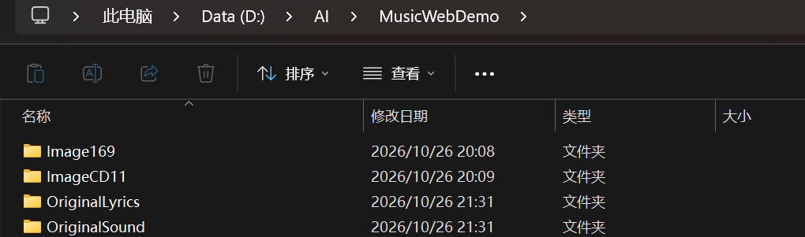

**2. 音频文件夹 (OriginalSound)**

所有 `.mp3` 音频文件都需放置于此，并在代码中对应引用。

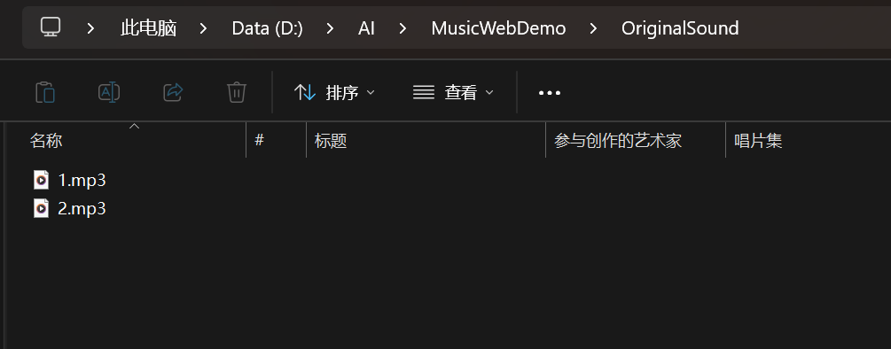

**3. 歌词文件夹 (OriginalLyrics)**

存放与音频同名的 `.lrc` 歌词文件，用于实现动态歌词滚动。

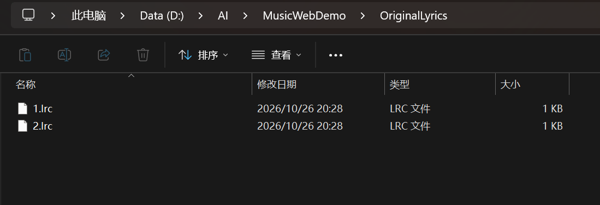

**4. 图片文件夹 (Image169 & ImageCD11)**

分别存放 16:9 的背景图和 1:1 的 CD 封面图。

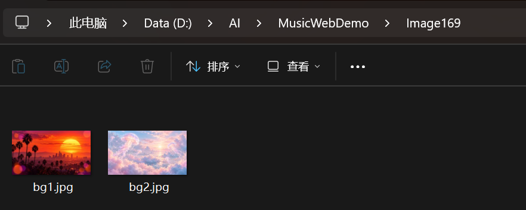

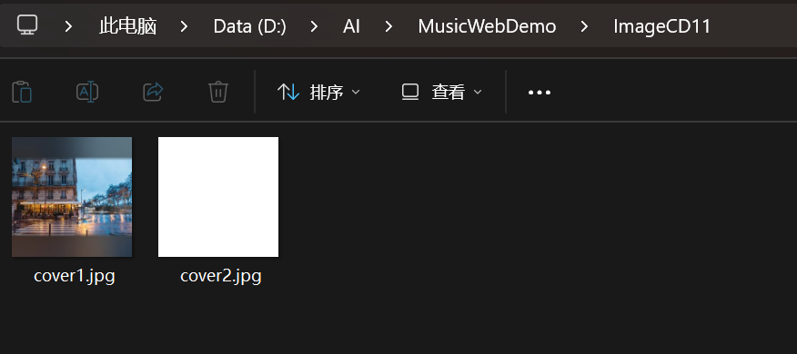

## 🚀 第一次运行

### 1. 安装工具

需要：

- Visual Studio Code，简称 VS Code。
- VS Code 扩展：Live Server。

在 VS Code 左侧打开扩展面板，搜索 `Live Server` 并安装。

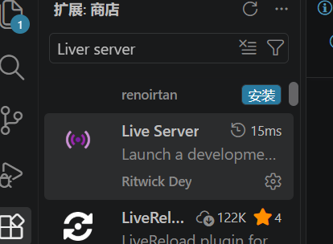

### 2. 打开项目

1. 打开 VS Code。
2. 点击“文件 → 打开文件夹”。

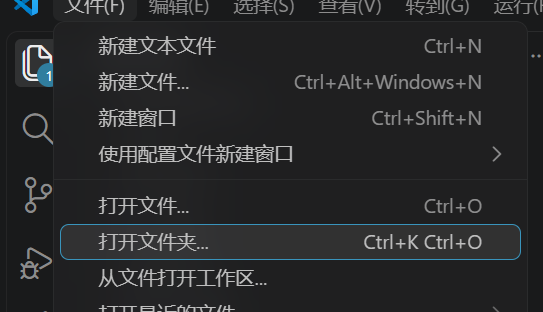

3. 选择 `MusicWebDemo` 文件夹。
4. 在左侧点击 `index.html`。

本地示例文件夹的位置是：

```text
D:\AI\MusicWebDemo
```

其他使用者可以把项目放到自己的任意文件夹。

### 3. 打开网页

在 HTML 编辑区域点击鼠标右键，选择：

```text
Open with Live Server
```

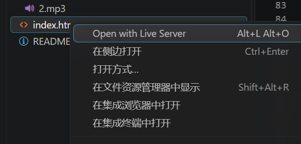

浏览器打开后，点击唱片或播放按钮开始播放。

⚠️ 【极其重要：请勿直接双击打开】

请务必使用 VS Code 的 Live Server 插件运行本项目。
错误做法：直接在文件夹里双击 index.html 文件用浏览器打开。这会导致浏览器的安全拦截（CORS 跨域限制），你会看到网页上没有歌词，甚至没有声音。
正确做法：在 VS Code 中右键点击 index.html，选择 Open with Live Server。
(原因：网页需要通过服务器环境去动态读取本地的 .lrc 歌词文件。)
错误做法示例：

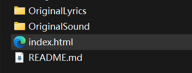

打开后会显示歌词暂不可用

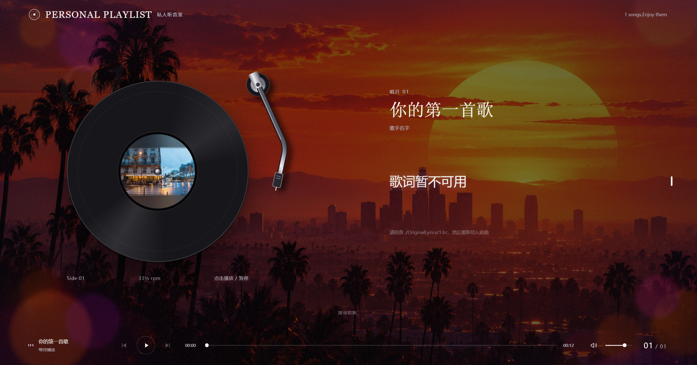

### 4. 记住这三个操作

- **Ctrl + F**：进行查找。
- **Ctrl + S**：保存修改。
- **刷新浏览器**：查看最新效果。

如果保存后 Live Server 已自动刷新，就不需要再手动刷新。

---

## ✨ 网页能做什么？

- 点击黑胶唱片播放、暂停。
- 播放时唱片旋转，唱臂落下。
- 上下滚动切换歌曲。
- 背景变化跟随滚动距离。
- 相邻歌曲的歌词随滚动边缘逐步显隐。
- 旧标题先退出，新标题再出现，避免两个歌名抢画面。
- 自动读取 LRC 并高亮当前歌词。
- 支持纯音乐展示。
- 点击页面出现光晕涟漪。
- 播放时显示音频频谱。
- 背景根据低频能量轻微缩放。
- 鼠标静止后自动隐藏。
- 支持手机端布局。
- 歌曲数量由配置决定，可以是一首、两首或更多首。

---

## 📝 模块一：修改标题和小标签(具体修改样例在末尾)

网页上的多数文字集中放在 `siteConfig` 里。

可以把它理解成“网页设置表”：想改什么文字，就在里面找到对应项。

### 第一步：找到设置表

在 `index.html` 中按：

```text
Ctrl + F
```

搜索：

```javascript
const siteConfig
```

示例：
Ctrl + F后右上角会有搜索框，下图有展示，输入了const siteConfig

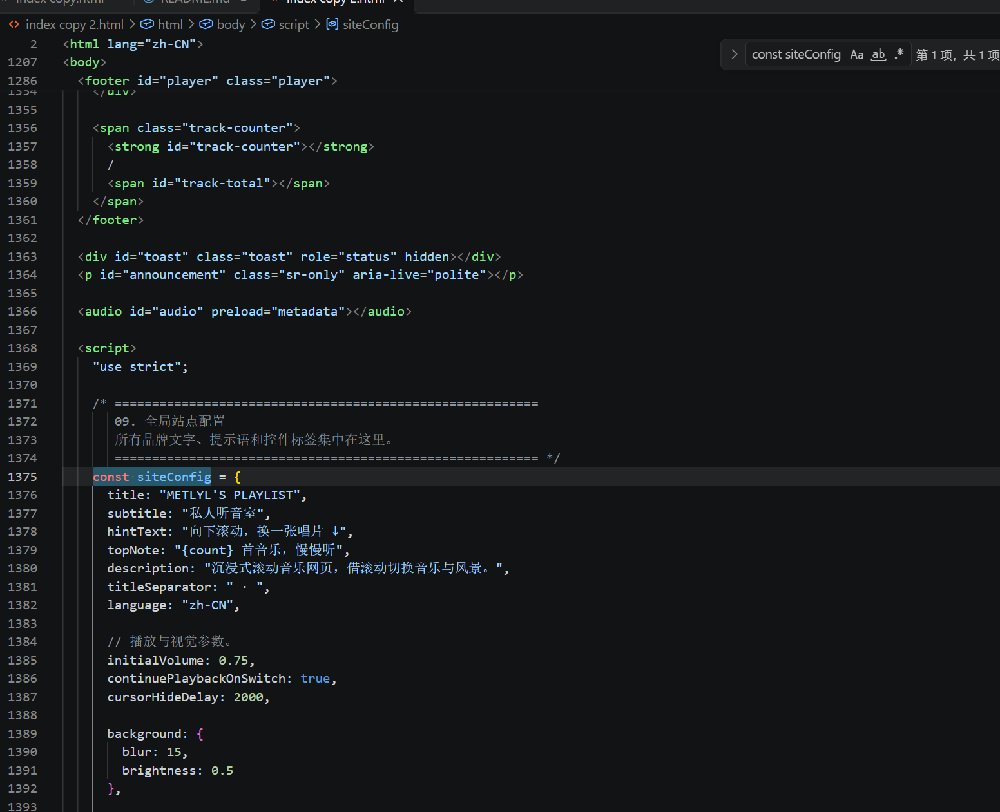

### 第二步：修改网页主标题、副标题和提示语

找到下面几项，只替换对应的内容：

```javascript
title: "我的音乐收藏",
subtitle: "戴上耳机，慢慢听",
hintText: "向下滚动，听下一首！",
topNote: "{count} 首音乐，慢慢听",
description: "这里收藏着我喜欢的音乐。",
```

它们的用途是：

| 配置名称 | 作用 |
| --- | --- |
| `title` | 左上角主标题 |
| `subtitle` | 左上角副标题 |
| `hintText` | 页面底部的滚动提示 |
| `topNote` | 页面顶部的歌曲数量提示 |
| `description` | 网页描述，不是页面中的可见标题 |

`{count}` 会自动变成歌单里的歌曲数量。

**保留 `{count}`，不需要手动把它改成 2。**

只修改已有字段，不要把整个 `siteConfig` 删掉重写。

### 第三步：修改唱片旁边的小标签

继续在 `siteConfig` 里面找到：

```javascript
text: {
```

这里放着按钮、状态和提示文字。

例如，可以修改已有的这些字段：

```javascript
recordLabel: "唱片 {number}",
sideLabel: "第 {number} 张唱片",
speedLabel: "慢慢听",
recordHint: "点击唱片，播放或暂停",
```

分别控制：

| 配置名称 | 作用 |
| --- | --- |
| `recordLabel` | 歌名上方的唱片编号 |
| `sideLabel` | 唱片区域的编号标签 |
| `speedLabel` | 原本显示 `33⅓ rpm` 的装饰文字 |
| `recordHint` | 唱片旁的操作提示 |

修改 `speedLabel` 只改变文字，不会改变歌曲播放速度。

`{number}` 是自动填写的编号，请保留。

### 第四步：修改播放状态和歌词提示

仍然在 `siteConfig.text` 中，可以修改：

```javascript
ready: "准备好就点播放",
playing: "正在聆听",
paused: "休息一下",
clickToPlay: "点击唱片，让音乐开始",
prelude: "前奏，静静听",
instrumental: "没有歌词，也有故事",
```

不要重复新增同名字段，找到原来的那一行直接替换即可。

如果看到下面这些带大括号的内容，请保留：

```text
{number}
{title}
{count}
{path}
{current}
{total}
```

它们会由网页自动填入实际内容。

### 第五步：保存并查看

按 **Ctrl + S**，回到浏览器查看效果。

部分提示会在滚动后隐藏，手机窄屏也会隐藏部分装饰标签。查看完整效果时，请使用桌面宽度的浏览器窗口，并回到页面顶部。

以下是修改样例:
修改title-language部分,修改之前的代码和样例图:


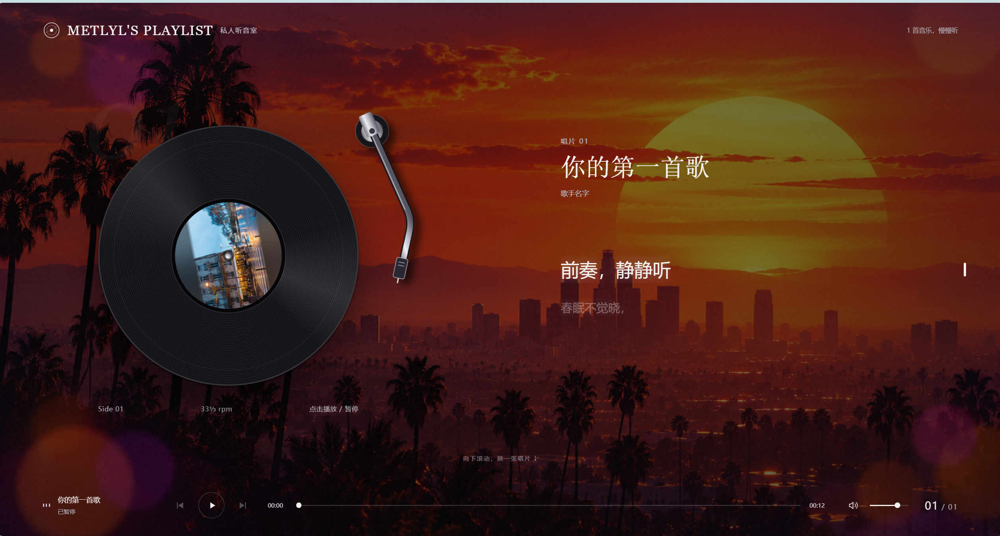

修改之后的代码和样例图:

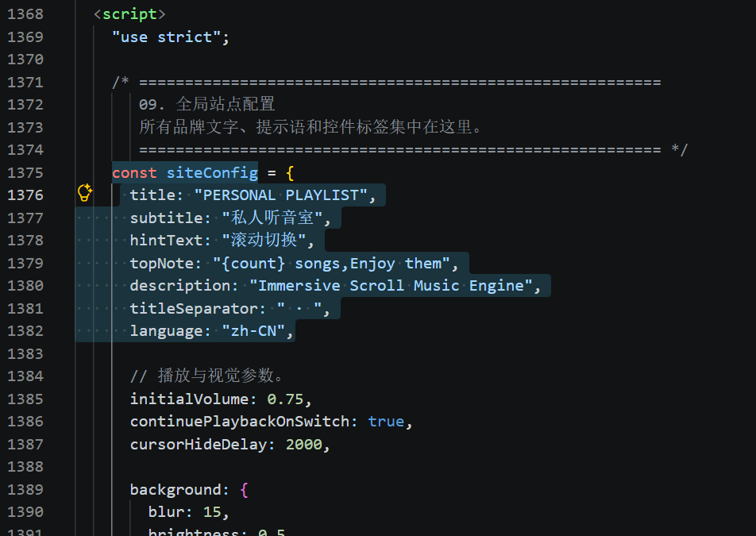

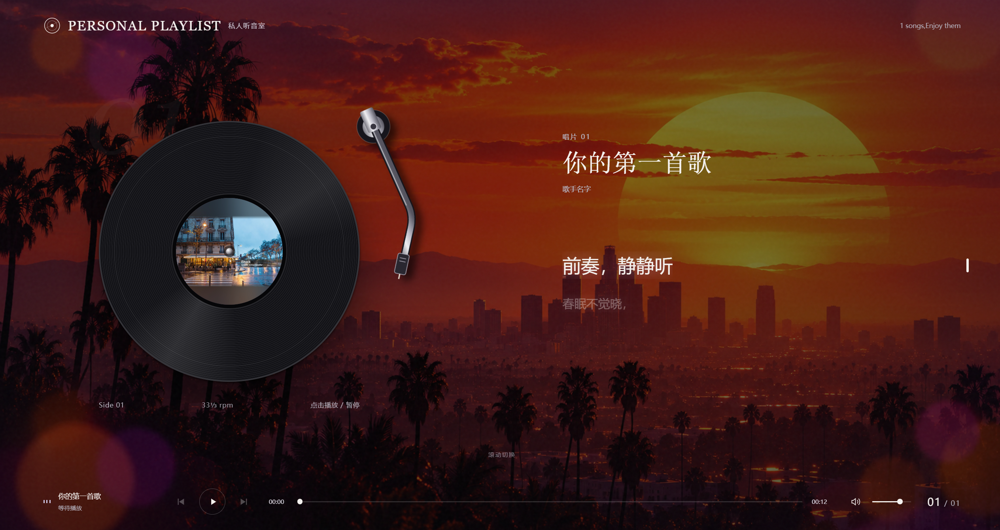

## 🎵 模块二：添加第二首歌

项目已经准备好了第二首的音频、歌词、封面和背景。

现在只需要把它写进歌单。

### 第一步：找到歌单

在 HTML 中按 **Ctrl + F**，搜索：

```javascript
const songs
```

示例:

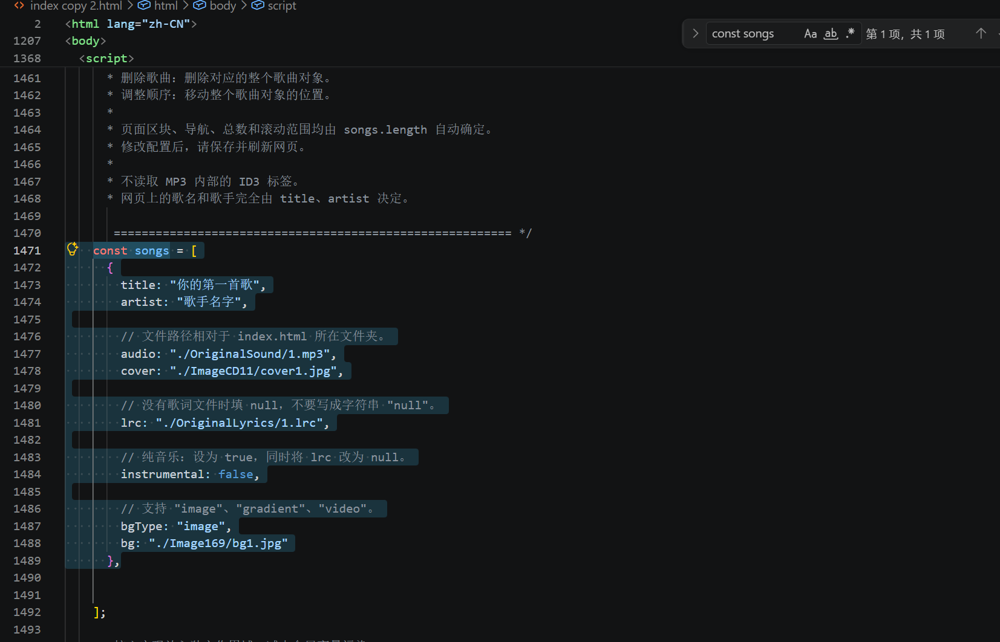

你会看到一个数组。

可以把它理解成一张歌曲清单：

**一个完整的 `{ ... }`，就是一首歌。**

### 第二步：找到插入位置

当前第一首歌结束后，会有：

```javascript
    },
];
```

新的第二首歌要放在：

- 第一首结尾的 `},` 后面。
- 整个数组结尾的 `];` 前面。

不要放到 `];` 后面。

### 第三步：插入第二首的配置

粘贴下面这一整块：

```javascript
    {
        title: "我的第二首歌",
        artist: "第二首歌的歌手",
        audio: "./OriginalSound/2.mp3",
        cover: "./ImageCD11/cover2.jpg",
        lrc: "./OriginalLyrics/2.lrc",
        instrumental: false,
        bgType: "image",
        bg: "./Image169/bg2.jpg"
    },
```

粘贴完应该是这样的：

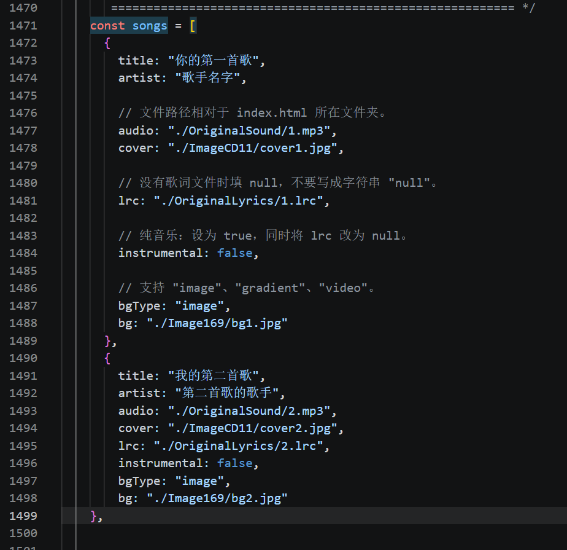

上面的素材路径对应项目中已经准备的第二套文件。

把 `title` 和 `artist` 改成你希望显示的歌名、歌手。

### 添加完成后的完整歌单

为了方便核对，下面是一份完整的两首歌示例：

```javascript
const songs = [
    {
        title: "我的第一首歌",
        artist: "第一首歌的歌手",
        audio: "./OriginalSound/1.mp3",
        cover: "./ImageCD11/cover1.jpg",
        lrc: "./OriginalLyrics/1.lrc",
        instrumental: false,
        bgType: "image",
        bg: "./Image169/bg1.jpg"
    },
    {
        title: "我的第二首歌",
        artist: "第二首歌的歌手",
        audio: "./OriginalSound/2.mp3",
        cover: "./ImageCD11/cover2.jpg",
        lrc: "./OriginalLyrics/2.lrc",
        instrumental: false,
        bgType: "image",
        bg: "./Image169/bg2.jpg"
    },
];
```

完成后刷新网页,滚动鼠标可以看见第二首歌,如图:

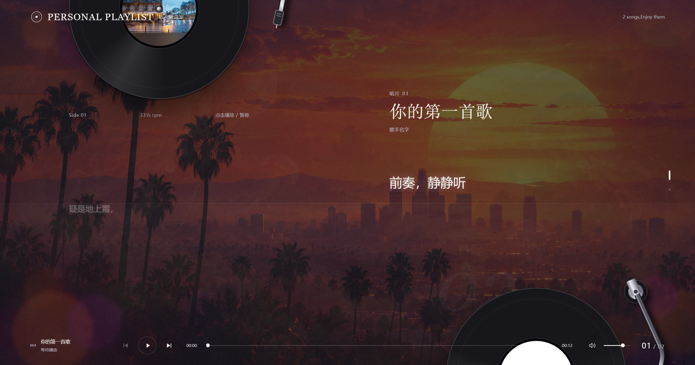

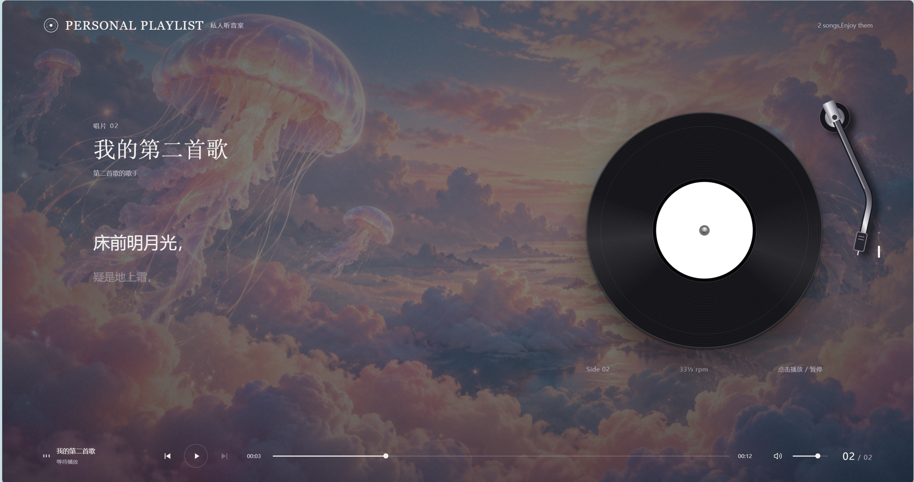

如果第一首的名称已经改好了，就保留自己的文字，不必改回示例名称。

### 每个字段是什么意思？

| 字段 | 填写内容 |
| --- | --- |
| `title` | 网页上显示的歌名 |
| `artist` | 网页上显示的歌手 |
| `audio` | 音频文件路径 |
| `cover` | 黑胶封面图片路径 |
| `lrc` | 歌词文件路径 |
| `instrumental` | 是否为纯音乐 |
| `bgType` | 背景类型，本教程使用 `"image"` |
| `bg` | 全屏背景图片路径 |

`./` 表示“从当前 HTML 所在文件夹开始找”。

例如：

```javascript
audio: "./OriginalSound/2.mp3",
```

就是寻找同级 `OriginalSound` 文件夹中的 `2.mp3`。

### 第四步：保存并检查

1. 按 **Ctrl + S**。
2. 刷新浏览器。
3. 向下滚动。
4. 检查第二首的歌名、封面和背景是否出现。
5. 点击第二首唱片，检查音频是否能播放。

页面高度、歌曲导航和总数会自动更新。

## ➖ 模块三：删除第二首歌(不做图片展示,删除之前加入的歌曲信息代码即可)

如果只想保留第一首，删除第二首的完整配置即可。

### 第一步：选中第二首的整块代码

找到：

```javascript
    {
        title: "我的第二首歌",
        artist: "第二首歌的歌手",
        audio: "./OriginalSound/2.mp3",
        cover: "./ImageCD11/cover2.jpg",
        lrc: "./OriginalLyrics/2.lrc",
        instrumental: false,
        bgType: "image",
        bg: "./Image169/bg2.jpg"
    },
```

从开头的 `{`，一直选到最后的 `},`。

### 第二步：按 Delete 删除

删除时注意：

- 删除整个歌曲对象。
- 不要只删除歌名那一行。
- 不要留下空的 `{}`。
- 不要删掉第一首。
- 不要删掉最外层的 `[` 和 `];`。

第一首末尾保留逗号是允许的。

### 第三步：保存并刷新

网页会自动恢复为一首歌：

- 只保留一个歌曲区块。
- 歌曲总数变为 1。
- 导航数量减少。
- 页面高度自动缩短。

删除配置不会删除电脑上的素材文件。第二首的 `2.mp3`、`2.lrc` 等文件仍然保留，以后还可以重新添加。

## 🔧 补充：修改歌曲、调整顺序和继续加歌

### 修改歌名和歌手

直接修改：

```javascript
title: "你喜欢的歌名",
artist: "歌手名字",
```

Ctrl + F 搜索const songs定位到歌曲数组,在里面修改以上内容
网页不依赖 MP3 内部的 ID3 标签。

即使音频文件只叫 `1.mp3`，也可以在网页上显示任意填写的歌名。无需使用其他软件给 MP3 写入标题或歌手。

### 调整歌曲顺序

移动整个歌曲对象的位置即可。

数组中第一块就是第一首，第二块就是第二首。网页不按音频文件名排序。

### 添加第三首、第四首

继续在数组末尾添加歌曲对象，并填写真实素材路径即可。

例如第三首可以使用：

```javascript
audio: "./OriginalSound/3.mp3",
```

但请先自行准备 `3.mp3`。本示例文件夹只准备了两套素材，不包含第三首。

框架没有固定的两首或六首限制，但歌曲越多，素材管理和加载体积越需要注意。

### 没有歌词文件

如果是有人声的歌曲，但没有 LRC：

```javascript
lrc: null,
instrumental: false,
```

如果是纯音乐：

```javascript
lrc: null,
instrumental: true,
```

`null`、`true`、`false` 都不加引号。

### 修改后为什么需要刷新？

网页会在加载时读取 `songs` 并生成区块。

修改数组后，保存并刷新即可。当前版本不提供网页内上传歌曲、编辑歌单和持久保存的管理界面。

---

## 🎹 模块四：进阶玩法二——按 E 键慢慢滑到下一首

这个功能是可选的。

添加后，按一下 **E**，页面会在指定时间内滑到下一首。鼠标正常滚动仍然可以使用。

本示例没有视频素材，因此不演示视频背景扩展。

### 第一步：确认有两首歌

如果刚才删除了第二首，请先重新添加。

只有一首歌时，没有“下一首”，按 E 不会滚动。

### 第二步：找到脚本插入位置

在 HTML 文件中按 **Ctrl + End**，来到文件底部。

找到：

```html
</body>
```

把下面的新脚本放在 `</body>` 前面，而且要放在原来的主脚本之后。

位置示意：

```html
<!-- 原来的主脚本到这里结束 -->
</script>

<!-- 在这里添加新的 E 键脚本 -->

</body>
</html>
```

示例:

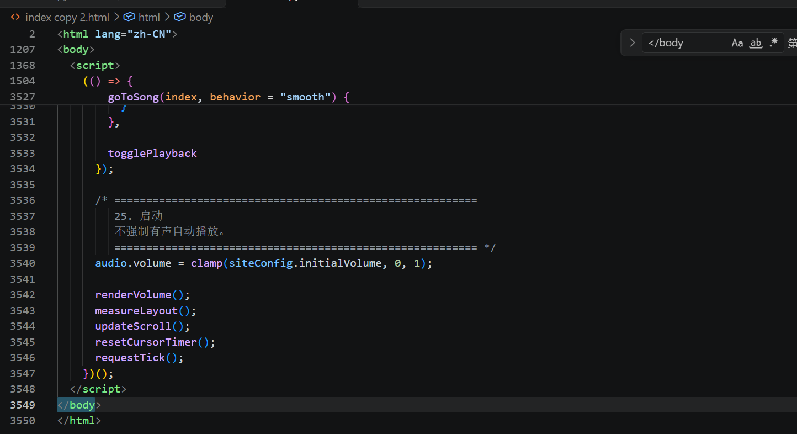

不要把新的 `<script>` 标签粘进原来的 `<script>` 内部。

### 第三步：粘贴完整扩展代码

```html
<script>
(() => {
    // 从当前位置滑到下一首所需的时间。
    // 单位是毫秒：12000 = 12 秒，5000 = 5 秒。
    const duration = 12000;

    let frameId = 0;

    // 停止自动滑屏，让用户随时可以接管。
    function cancelScroll() {
        if (frameId) {
            cancelAnimationFrame(frameId);
            frameId = 0;
        }
    }

    // 开始和结束慢一些，中间快一些。
    function easeInOutCubic(t) {
        return t < 0.5
            ? 4 * t * t * t
            : 1 - Math.pow(-2 * t + 2, 3) / 2;
    }

    window.addEventListener("keydown", (event) => {
        const target = event.target;

        // 在输入框里打字时，不触发滑屏。
        const editing =
            target instanceof HTMLElement &&
            (
                target.isContentEditable ||
                target.closest(
                    "input, textarea, select, [role='textbox']"
                )
            );

        if (
            editing ||
            event.isComposing ||
            event.defaultPrevented ||
            event.ctrlKey ||
            event.metaKey ||
            event.altKey ||
            event.shiftKey
        ) {
            cancelScroll();
            return;
        }

        // 按其他键时，停止自动滑屏。
        if (event.code !== "KeyE") {
            cancelScroll();
            return;
        }

        event.preventDefault();

        // 长按 E 时，不重复启动动画。
        if (event.repeat) return;

        const engine = window.musicEngine;

        if (!engine || engine.currentIndex < 0) return;

        const nextIndex = engine.currentIndex + 1;

        // 已经是最后一首，就不再向下。
        if (nextIndex >= engine.songCount) return;

        const sectionTop = engine.getSectionTop(nextIndex);
        if (sectionTop === null) return;

        cancelScroll();

        const startY = window.scrollY;

        const maxY = Math.max(
            0,
            document.documentElement.scrollHeight - window.innerHeight
        );

        const targetY = Math.max(
            0,
            Math.min(sectionTop, maxY)
        );

        // 系统设置为减少动态效果时，直接到下一屏。
        const reduceMotion = window.matchMedia(
            "(prefers-reduced-motion: reduce)"
        ).matches;

        if (reduceMotion || duration <= 0) {
            window.scrollTo({
                top: targetY,
                behavior: "instant"
            });
            return;
        }

        const startedAt = performance.now();

        function step(now) {
            const progress = Math.min(
                1,
                (now - startedAt) / duration
            );

            window.scrollTo({
                top:
                    startY +
                    (targetY - startY) * easeInOutCubic(progress),
                behavior: "instant"
            });

            if (progress < 1) {
                frameId = requestAnimationFrame(step);
            } else {
                frameId = 0;
            }
        }

        frameId = requestAnimationFrame(step);
    });

    // 用户滚动、点击、触摸时，停止自动滑屏。
    window.addEventListener("wheel", cancelScroll, { passive: true });
    window.addEventListener("pointerdown", cancelScroll, { passive: true });
    window.addEventListener("touchstart", cancelScroll, { passive: true });
    window.addEventListener("resize", cancelScroll);

    document.addEventListener("visibilitychange", () => {
        if (document.hidden) cancelScroll();
    });
})();
</script>
```

粘贴完后应该是这样的:

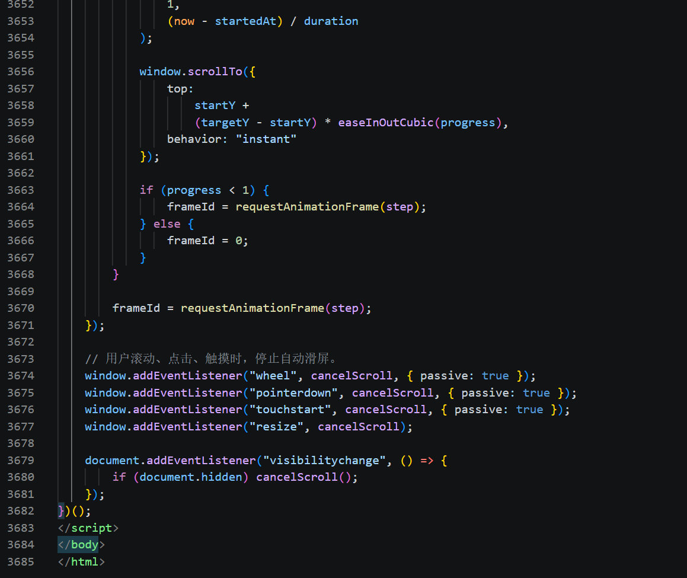

这段脚本使用当前页面已有的 `window.musicEngine` 接口。

只添加一次。如果已经添加过 E 键扩展，请替换旧扩展，不要重复粘贴。

### 第四步：试用

1. 保存文件，刷新网页。
2. 回到第一首歌的位置。
3. 点击网页空白处，让键盘焦点进入网页。
4. 切换到英文输入状态。
5. 按一下 E。
6. 暂时不要滚动或点击鼠标，观察页面自动移动。

如果想听到切歌效果，先点击第一首唱片播放，再按 E。

标题、歌词和背景会继续按照页面滚动位置变化。

歌曲仍然在原来的切歌阈值处切换，不是等满 12 秒才切歌。

### 第五步：修改滑动时间

找到扩展里(就是刚刚粘贴的代码)的这一行：

```javascript
const duration = 12000;
```

改成：

```javascript
const duration = 5000;
```

就会变成 5 秒。

| 填写数字 | 对应时间 |
| --- | --- |
| `3000` | 3 秒 |
| `5000` | 5 秒 |
| `12000` | 12 秒 |

这里控制的是从当前滚动位置到下一屏的整段时间。

### 第六步：中途停止

自动滑屏时，可以：

- 滚动鼠标滚轮。
- 点击页面。
- 按其他键。
- 在触屏设备上触摸页面。

这些操作会结束本次自动滑屏。

### 不想要这个功能了？

删除刚才新增的整个 `<script>...</script>` 块，保存刷新即可。

不要删除原来的主脚本。

## ⚙️ 其他常用设置

下面这些选项也在已有的 `siteConfig` 中。

找到原字段修改即可，不要重新粘贴一个同名对象。

### 初始音量

```javascript
initialVolume: 0.75,
```

`0.75` 表示初始音量为 75%，范围是 `0` 到 `1`。

### 切歌后是否继续播放

```javascript
continuePlaybackOnSwitch: true,
```

- `true`：原来正在播放时，切歌后尝试继续播放。
- `false`：切歌后等待用户点击播放。

### 鼠标多久不动就隐藏

```javascript
cursorHideDelay: 2000,
```

`2000` 表示 2 秒，改成 `0` 可以关闭自动隐藏。

### 背景明暗

在 `background` 中找到：

```javascript
brightness: 0.5
```

- 数字小一点，背景更暗。
- 数字大一点，背景更亮。

### 开关互动效果

在 `effects` 中修改：

```javascript
ripple: true,
spectrum: true,
bassBreathing: true,
```

对应：

- `ripple`：点击光晕。
- `spectrum`：音频频谱。
- `bassBreathing`：背景随低频轻微缩放。

把需要关闭的那一项改成 `false` 即可。

---

## ❓ 遇到问题先看这里

### 修改了文字，网页却没变化

检查：

1. 是否按 Ctrl + S 保存。
2. 浏览器是否刷新。
3. 修改和运行的是否都是 `index.html`。

本项目有两个 HTML 文件，尤其要注意第三点。

### 添加第二首后页面出错

检查两首歌曲对象之间是否少了英文逗号：

```javascript
},
{
```

还要检查引号、大括号和方括号是否完整。

### 音频或图片打不开

检查代码路径是否与文件名完全一致。

例如：

```javascript
"./ImageCD11/cover2.jpg"
```

必须能找到对应的 `cover2.jpg`。

使用正斜杠 `/`，不要填写电脑绝对路径 `D:\...`。

### 歌词没有出现

检查：

- 是否通过 Live Server 打开。
- `lrc` 路径是否正确。
- 歌词是否包含时间戳。
- 是否误把 `instrumental` 设置为 `true`。

LRC 时间戳格式示例：

```text
[00:00.00]前奏
[00:12.50]这里是第一句歌词
[00:18.20]这里是第二句歌词
```

### 按 E 没反应

检查：

- 歌单里是否至少有两首歌。
- 是否已经停在最后一首。
- 浏览器焦点是否在网页，而不是地址栏或 VS Code。
- 扩展脚本是否放在原主脚本之后。
- 是否正在使用输入法组字。
- 是否保存并刷新了页面。

### 为什么按 E 直接跳过去，没有慢慢滚动？

如果系统开启了“减少动态效果”，扩展会尊重这个设置，直接定位到下一屏。

### 为什么打开页面没有立即出声？

浏览器通常要求用户先点击一次，才允许有声音的播放。点击唱片或播放按钮即可。

### 关于其它的拓展内容

本文提到的扩展内容只含有背景换视频和E键页面滚动,如有别的想法还请自行添加测试

---

## ⚠️ 关于开源与素材版权

代码框架与歌曲素材是两回事。

本地演示文件夹中准备的音频、歌词、封面和背景图，并不代表它们可以自由上传、转载或公开分发。